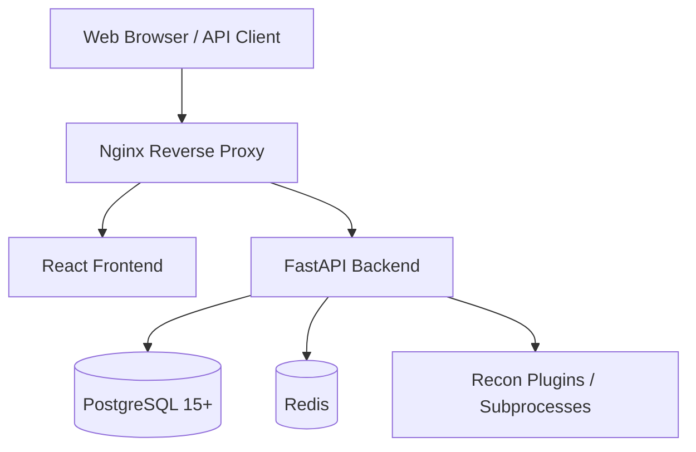

# Architecture Overview

VulnForge is built using a modern, scalable, and fully asynchronous architecture designed to handle large-scale reconnaissance and vulnerability data processing.

## 1. High-Level Architecture

## 2. The Frontend (React & Tailwind CSS v4)
- **Framework**: React 18 with Vite for lightning-fast HMR and optimized builds.
- **Styling**: Tailwind CSS v4 utilizing the new `@theme` engine for highly customizable dark/glassmorphic aesthetics.
- **Routing**: `react-router-dom` handles nested layouts, separating authentication screens from the heavy `ProjectLayout` dashboard.
- **State Management**: Context APIs handle User Authentication and Workspace isolation.
- **Security**: The frontend handles JWT tokens securely and relies on the Nginx proxy to eliminate CORS complexities in production.

## 3. The Backend (FastAPI & SQLAlchemy 2.0)
The backend is strictly typed and purely asynchronous.

### Core Layers:
1. **API Routers (`app/api/v1/`)**: Thin layers that receive HTTP requests, enforce Role-Based Access Control (RBAC), validate JSON against Pydantic schemas, and immediately hand off to Services.
2. **Services (`app/services/`)**: The "Brain" of the application. They enforce business logic (e.g., verifying a user is a Workspace Owner before deletion).
3. **Repositories (`app/repositories/`)**: The Data Access Layer. All SQL queries live here. They use SQLAlchemy 2.0 paradigms with `selectinload` for highly optimized eager loading (preventing N+1 queries).

### Database Deduplication
VulnForge utilizes PostgreSQL's powerful `JSONB` data type for the `DiscoveredAsset` table. 
Instead of creating dozens of tables for CMS, Frameworks, and Open Ports, the `AssetRepository` dynamically merges structured `JSONB` metadata across multiple tool scans using PostgreSQL's native `||` operator.

## 4. The Plugin Engine (`app/plugins/`)
VulnForge is designed to be highly extensible. The Recon Engine dynamically loads Python modules that inherit from `BasePlugin`.

When a scan is initiated:
1. The engine instantiates plugins (e.g., `NmapPlugin`, `NucleiPlugin`, `GowitnessPlugin`).
2. The plugins spawn safe asynchronous subprocesses to run underlying binaries.
3. The raw output (JSON/XML) is parsed and mapped into VulnForge's normalized `DiscoveredAsset` and `Vulnerability` Pydantic schemas.
4. The backend stores the findings in the database.

## 5. Reporting Engine
The `ReportingService` leverages `Jinja2` templates located in `app/templates/reports/` to generate rich executive summaries. It aggregates vulnerabilities by severity, formats Asset Metadata, and uses `wkhtmltopdf` via the `pdfkit` wrapper to convert the raw HTML into professional PDF deliverables.
